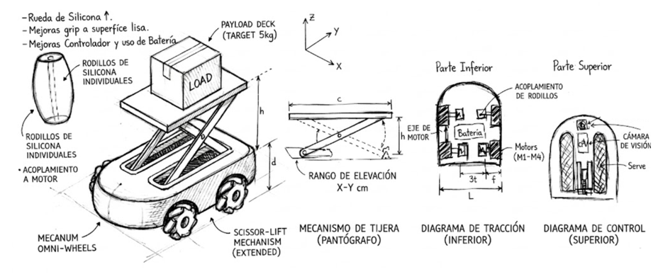
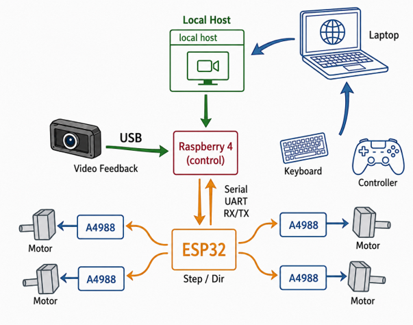
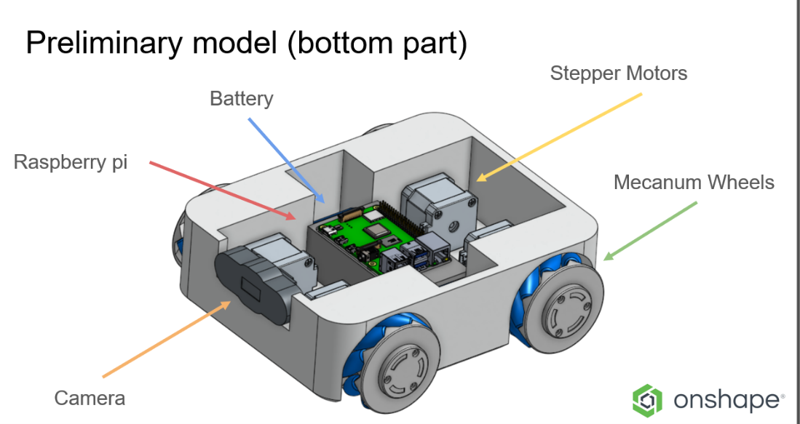
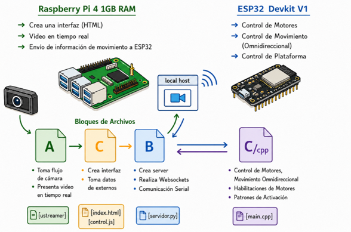

# OmniBot

OmniBot es una plataforma robótica móvil omnidireccional equipada con 4 ruedas Mecanum y operada de forma remota, con el fin de ser utilizada en pruebas de laboratorio para la programación de entornos de Warehouse y experimentar con el comportamiento de diversas clases de estos robots en un circuito cerrado, una habitación pequeña, para así estudiar el comportamiento de estos robots y la optimización de esta clase de espacios. 

<p align="center">
  
</p>


El sistema utiliza una arquitectura distribuida que integra una Raspberry Pi para el servidor de teleoperación web y el streaming de video, junto con un ESP32 que se encarga completamente del control de hardware de bajo nivel.

<p align="center">
  
</p>

## 🚀 Características Principales

*   **Movimiento Omnidireccional:** Plataforma impulsada por motores paso a paso y ruedas Mecanum (con rodillos de 14 mm, realizados en con moldes de compresión de silicón impresos en 3D).
*   **Teleoperación Web en Tiempo Real:** Interfaz de control desarrollada con Flask y SocketIO. Los eventos web se capturan con JavaScript y se procesan en el servidor.
*   **Visión Artificial / Streaming:** Captura de video en alta resolución utilizando `ustreamer`, lanzado y gestionado como un subproceso (`subprocess`) desde Python.
*   **Comunicación Segura UART:** Enlace serial entre la Raspberry Pi y el ESP32 utilizando tramas de datos estructuradas con Checksum para garantizar la integridad de las señales de los motores.

<p align="center">
  
</p>

## 📂 Estructura del Repositorio

*   📁 **`Control_Script`**: Scripts principales en Python para el servidor Flask, gestión de WebSockets y la lógica de envío serial.
*   📁 **`Electronic_Design`**: Esquemáticos y diseños de placas de circuito impreso (PCB) para la integración de los drivers DRV8825 y el microcontrolador, junto con implementaciones extra de circuitos para control del motor de la plataforma del modelo.
*   📁 **`Mechanic_Design`**: Modelado CAD 3D de la estructura mecánica, incluyendo bocetos preliminares y piezas para impresión 3D.
*   📁 **`System_Scripts`**: Scripts del sistema utilizados para levantar procesos auxiliares, como el stream de la cámara con ustreamer y el funcionamiento de los calls del servidor.


<p align="center">
  
</p>

## 🛠️ Tecnologías y Dependencias

Para el entorno del servidor en la Raspberry Pi, el proyecto requiere las siguientes dependencias de Python:

*   `flask`
*   `flask-socketio`
*   `simple-websocket`
*   `pyserial`

**Dependencias del Sistema:**
*   `ustreamer` (Debe estar compilado/instalado en la Raspberry Pi para la captura y transmisión de imagen).

## ⚙️ Instalación y Uso

1. **Clonar el repositorio:**
   ```bash
   git clone [https://github.com/AbeloTales/OmniBot.git](https://github.com/AbeloTales/OmniBot.git)


2. **Instalar las dependencias en el Raspberry Pi:**
   ```bash
   pip install flask flask-socketio simple-websocket pyserial

2. **Ejecutar el archivo principal del servidor:**
   ```bash
   cd ~/OmniBot/Control_Script
   python3 servidor.py

## 💻 Declaración de Uso - Inteligencia Artificial.
   La inteligencia artificial en este proyecto fue utilizada como herramienta para realizar la programación del servidor alojado en el RaspberryPi y el script que se encarga de controlar y procesar las señales de respuesta del servidor en el ESP32.

   Además, se usó inteligencia artificial para colorear los bocetos hechos a mano para un mejor entendimiento del proceso de diseño.

   El componente electrónico, mecánico y eléctrico de diseño del proyecto fueron trabajados sin ayuda de inteligencia artificial.

